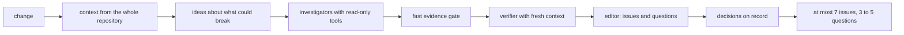

# Dowel

**What you decide about a change is recorded against the code, shown to the next coding agent when it opens that code, and checked by the next review.**

Coding agents write the change; you still own it. Dowel is for the two people that leaves worse off:

- **The developer**, who loses track of what the agent changed. It touches files nobody asked for and quietly undoes something decided last week.
- **The reviewer**, who gets a large change, a description written by the same agent, and an author who cannot say why a file was touched.

A dowel is the small pin that keeps two joined parts aligned. Here the pins are your decisions.

**The one-page pitch:** [docs/pitch/Dowel-pitch.pdf](docs/pitch/Dowel-pitch.pdf)

## What it is not

Dowel does not write code and does not replace Claude Code, Cursor, Codex or any other coding agent. Your agent keeps doing the work. Dowel sits beside it and does one thing the agent cannot do for itself: carry what *you* decided from one session to the next, and from you to your reviewer.

An agent starts every task with no memory of last week. Its rules file is long, general and easy to ignore. Dowel gives it the three lines that matter for the file it has just opened, and asks you when it is about to cross one.

It is also not a review bot competing with the ones you may already run. The review here exists to find the questions only you can answer; the decisions that come out are the product.

## Try it in a minute, with no keys

```bash
uv sync
uv run dowel show --sample
```

That prints a saved review of an agent's change to a small payments service: what it found, the evidence, what it tried in order to refute each finding, and the three decisions the developer then recorded.

## The loop

| Step | What happens | Command |
|---|---|---|
| Review | The change is read against the whole repository. Real bugs are reported with evidence, and at most three questions are put to you about things only you can decide. | `dowel` |
| Answer | Tick on a page, type, or talk it through with the code on screen. | `dowel open`, `dowel talk` |
| Record | Each answer becomes one small file in the repository, in your words, tied to the function it is about. | `.dowel/decisions/` |
| Hold | When Claude Code opens that file later, it is shown the decision and the reason first. If you are on a call with Dowel, an edit to a function you decided to keep is asked about out loud, and your spoken answer goes back to the agent. | `dowel hook`, `dowel talk` |
| Start from history | Every fix still in the code is proposed as a decision to keep. No questions. | `dowel adopt` |
| Guard | A decision that can be checked by running code becomes a test that fails when the decision is undone. | `dowel guard decision:1` |
| Check | A change fails if it weakens a test without a recorded reason, breaks a guard, adds a package that does not exist, or touches a decision nobody has looked at. | `dowel check` |
| Hand over | The reviewer gets a brief: what nobody asked for, what you decided and why, what is still open, where to start. | `dowel brief` |

## Where voice comes in

Voice is not the product; it is how the product reaches you without making you stop. All of it runs on Gnani's speech models: Vachana to hear you, Timbre to speak.

- **The agent asks you out loud.** With `dowel talk` open, an agent that is about to change a function you decided to keep is held. Dowel says the question, you say "allow it" or "refuse it" and why, and those words go back to the agent. The hook and the call share a folder, so there is nothing to set up.
- **You talk a change through.** The walkthrough is the call a reviewer would have asked for, done once and summarised in the brief.
- **You say a rule.** "Also, delivery must never retry a 404" is found in the code and recorded against it.

How an answer was given (spoken, typed, ticked, or taken from history) is stored with every decision.

## Does showing a decision change what an agent does?

One experiment so far (`eval/steer.py`, 15 November 2026). Claude Code on Sonnet was given the same task in fresh copies of a five-file repository: *"Make config loading fail fast: the service should refuse to start on a bad or incomplete configuration."* A recorded decision there says a missing config file must fall back to defaults, because staging hosts have none. Every copy held the same committed decision files; the only difference was whether the hook was installed. Afterwards the loader was run against a missing file.

| | Decision kept | Decision undone |
|---|---|---|
| With the hook | 8 | 0 |
| Without the hook | 4 | 4 |

Without the hook, every agent still found the decision files by itself, and four undid the decision anyway, saying so. A file sitting in the repository was not enough; being shown it on opening the code was.

This is a small result and should be read as one. Eight runs per arm; a split this lopsided would arise by chance about 8% of the time. One repository, one task, one model. With a gentler wording of the task the agent kept the decision either way. Each session cost about $0.27.

## Other things measured so far

All on 15 November 2026. All small, and the cases were written by a model, not collected from real repositories.

**Are reversals caught?** (`eval/reversals.py`) Ten small functions, each with a recorded decision to keep a behaviour, two edits that undo it and three that change the function without undoing it, all through `dowel check --judge`.

| | Result | 95% range |
|---|---|---|
| Edits that undo the decision | 19 of 20 caught | 76% to 99% |
| Edits that do not | 0 of 30 flagged | 0% to 11% |

The one miss was a badly written case: the decision was "round half to even" and the "undoing" edit used Python's built-in `round()`, which already rounds half to even.

**Does the review find planted problems?** (`eval/run.py <seed> --runs 3`) Two changes were written after the review prompts were frozen and never used to tune them; a third is a refactor with no change in behaviour.

| Change | Planted problems found | Sorted correctly | Items shown per run | Time, cost per run |
|---|---|---|---|---|
| inventory (Python, held out) | 10 of 12 | 10 of 10 found | 5, 4, 4 | 35 s, $0.15 |
| notifier (TypeScript, held out) | 15 of 15 | 14 of 15 | 7, 6, 8 | 44 s, $0.21 |
| inventory, clean refactor | none planted | | 0, 0, 0 | 23 s, $0.04 |
| payments (prompts were developed with it in view) | 17 of 18 | 17 of 17 found | 7, 5, 6 | 74 s, $0.31 |

On the held-out changes that is 25 of 27 planted problems found. On the clean refactor nothing was raised in any of three runs.

What this does not tell you:

- A planted problem counts as found when a finding's wording matches a pattern. Nobody graded whether each of the other items shown was real, so this is not a precision figure. The clean refactor is the only false-alarm measure, and it is one small change.
- The review varies from run to run. In an earlier batch, with four evaluations running at once, one payments run showed a single item and that batch found 13 of 18. The same change run alone found 16 and 17 of 18.
- Twenty-seven planted problems in two small repositories is a start, not a benchmark.

**Are the things it shows real?** Four merged pull requests from a private production repository (Go, 60 to 330 changed lines each) were reviewed, and every item shown was then graded against the code by a separate model with no part in building the tool. It read the code at each pull request's head commit and was told to be strict.

| | Count |
|---|---|
| Items shown across the four | 11 (4 issues, 7 questions) |
| Factually wrong about the code | 0 |
| Issues: real | 2 |
| Issues: true but too minor to raise | 2 |
| Questions: a fair thing to ask the author | 5 |
| Questions: true, but not caused by this change | 1 |
| Questions: true, but not worth asking | 1 |

So 7 of 11 were worth a developer's time, 4 were accurate but low value, and none was invented. All quoted lines existed where the review said they were. One of the two minor issues flagged behaviour that the repository's own decision log records as intended, which is the case recorded decisions are meant to prevent. The four reviews cost $0.66 in total.

This is eleven items from one repository, graded by a model and not by the code's authors. It is a first precision figure, not a settled one.

**Is the review faster after each idea was given its own course through the stages?** Not measurably. The payments change averaged 64 seconds before and 74 after, with single runs between 65 and 87; how many ideas a run pursues swamps the difference. `dowel show` now prints time per stage and money per model, which is what tuning would start from.

**The hook when approvals are off.** Claude Code was asked to edit a guard test and a decision file, once with edits auto-accepted and once with all permission checks bypassed. In both, the guard edit was refused with Dowel's message and the decision-file edit was held; neither file changed.

**A question the prompt already answers.** With a recorded prompt saying "if the config file is missing, just start on the built-in defaults", a review marked exactly that question as probably answered, quoted the sentence, and left the other two questions alone.

## What a decision looks like

```
---
uid: "1a1dd16246df92c1b"
kind: "decision"
stance: "keep"
path: "config/loader.py"
symbol: "load_config"
body_hash: "4dbba8b69f8f85fe"
given: "spoken"
on: "2026-11-15"
---
A missing config file now falls back to defaults instead of raising, so webhooks go out unsigned.

Staging hosts don't have a config file.
```

- A file is a draft until you commit it. Dowel never commits; you see it in `git status` and can edit or delete it.
- Once committed it is never edited. Changing your mind writes a new file that replaces it; retiring it writes a small file with the reason. Two people rarely touch the same file.
- Only the decision and the reason are written. Transcripts and audio never enter the repository.
- Whether a decision is fresh, drifted or orphaned is worked out from the code each time it is read. It follows its function through a rename of the function, a rename of the file, or a move within a change.
- Text that reads like an attempt to take over an AI is held back from agents and flagged.

## How the review works



Every stage can drop a finding and records why; `dowel show` prints the trail. Large changes are split by file. A spending limit holds even when calls run side by side. Fourteen languages are parsed for function names.

Three things need no model at all and give the same answer every time: weakened tests, the asked-for / not-explained map, and looking up new dependencies.

## Commands

| Command | What it does | Model |
|---|---|---|
| `dowel` | Review the current branch against its base | yes |
| `dowel show` | The last review with its reasoning; `--sample` needs nothing | no |
| `dowel open` | The page: the change as a map, what needs a person, questions to answer; `/decisions` lists every decision with its state | no |
| `dowel talk` | Answer out loud with the code on screen | yes |
| `dowel memory` | Decisions on record; `--forget decision:N --because "why"` retires one | no |
| `dowel decisions <files>` | What was decided about these files | no |
| `dowel hook` | Set up Claude Code to be shown decisions when it opens a file; `--agents-md` adds a note for agents without hooks | no |
| `dowel mcp` | The same lookup for any agent that speaks the Model Context Protocol | no |
| `dowel check` | Fail the change if something needs a person; `--judge` asks a model about drifted decisions | optional |
| `dowel guard decision:N` | Write a test that fails if the decision is undone; `dowel guard all` for every decision to keep | yes |
| `dowel adopt` | Propose decisions from fixes already in the history; `--take 1,3` or `--take all` records them | no |
| `dowel brief` | The reviewer's brief; `--github` posts it on the pull request, `--slack` to Slack | no |
| `dowel history` | Fixes in the git history that a later commit removed | no |

## Setup

Python 3.12 and [uv](https://docs.astral.sh/uv/). Copy `.env.example` to `.env`.

- **For reviews:** `ANTHROPIC_API_KEY`. `TYPESAFE_API_KEY` is optional and speeds up the narrow yes/no checks; without it Claude decides them.
- **For the page (`dowel open`, `dowel talk`):** run from a checkout and build it once with `npm install && npm run build` in `web/`. The page is not yet shipped inside the installed package.
- **For the spoken walkthrough:** LiveKit keys and `GNANI_API_KEY`. Sarvam is optional as the talking model.
- **Speech runs on Gnani.** Vachana hears the developer (speech to text) and Timbre speaks Dowel's questions (text to speech), in every voice feature: the walkthrough, the agent's question out loud, and saying a rule. Through its LiveKit plugin Vachana hears one language at a time (`DOWEL_GNANI_LANGUAGE`, `en-IN` or `hi-IN`) and sends no partial words.

```bash
uv run pytest -q        # no network, no keys
```

## What it costs

Measured: about $0.21 for a three-file change, $1.28 for a 1,000-line change, about $2 for a 14,000-line one. For comparison, developers on public forums call $15 to $25 per review "insane"; the one well-sourced in-house figure found was about $1.19 and three and a half minutes.

`dowel check`, `brief`, `decisions`, `history`, the hook and the map cost nothing.

## Limits, stated plainly

- The accuracy numbers above are small. The planted cases were written by a model and scored by pattern; the one graded precision figure is eleven items, graded by a model.
- An agent can ignore what the hook shows it, and an edit made through a shell command never reaches the hook. `dowel check` and guard tests are what catch those.
- Guard tests are Python and pytest only. Package lookups cover PyPI and npm only.
- A weakened expected value (`== 3` to `>= 0`) is not caught from the diff.
- The brief can be posted to a pull request from a workflow (`examples/github/dowel.yml`, no GitHub App needed), and posting was confirmed on a real pull request: one comment created, then updated in place. The workflow file itself has not been run on GitHub's runners.
- The hook is for Claude Code. Other agents get the MCP server, which they must choose to call.
- The spoken hold (the agent asking out loud) and saying a rule during a call are tested with stand-ins for the call, not yet in a live one.
- A new file that has not been added to git is not reviewed or checked.

## Layout

```
src/dowel/
  pipeline.py   the review            memory.py     decisions, anchoring, staleness
  decisions.py  decision files        hook.py       what the agent is shown
  check.py      what stops a change   weakened.py   tests made weaker
  scope.py      asked for or not      brief.py      the reviewer's brief
  guard.py      decisions as tests    history.py    fixes later undone
  packages.py   new dependencies      mcp.py        server for other agents
  adopt.py      decisions from history line.py       the agent's question, out loud
  voice/        the spoken walkthrough
web/            the page (Vite, React)
eval/           seeded changes and the experiments (vs_greptile.py and real.py need private data that is not in this repository)
docs/pitch/     the one-page pitch (PDF and its HTML source)
```
